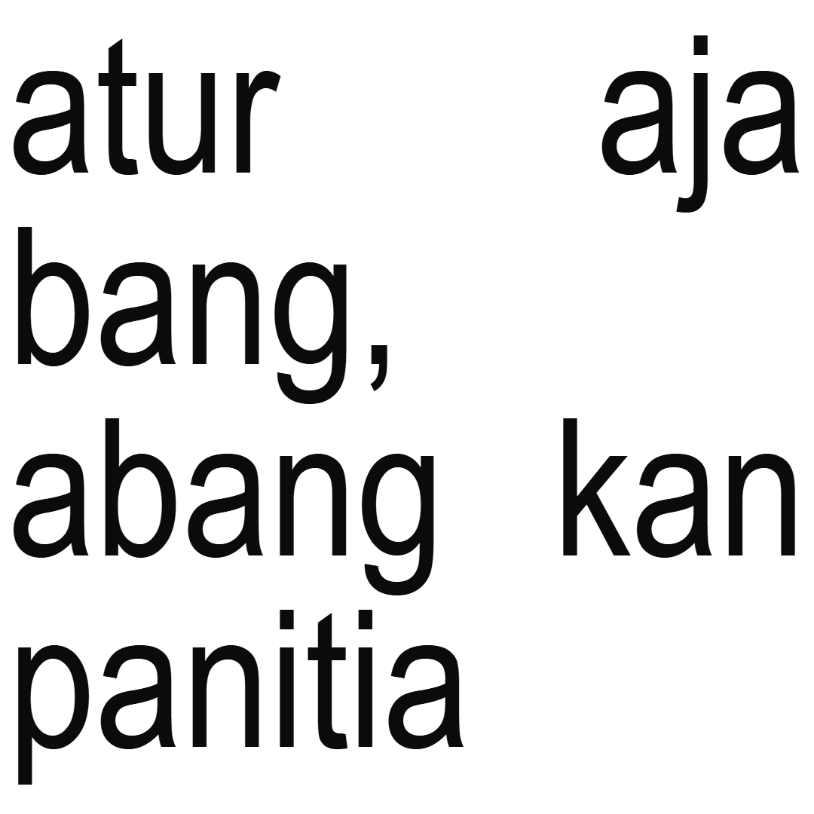
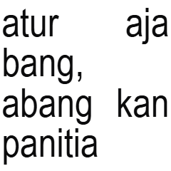

# Text Image

Turn a few lines of text into a black-on-white card and download it as a PNG.
Arial Narrow is the default face, the lines justify to the frame, and auto size
picks the largest type that fits. Export it square or 3:4, at full size or
low-res.

## Examples

| Standard (1080 px) | Low res (240 px) |
| --- | --- |
|  |  |

Both images come from the app's export path. The low-res file is a 240 px
bitmap; viewers scale it up and the type softens.

## What You Get

The preview uses the same layout and drawing code as the downloaded file, so
the type size and line breaks you see are the ones in the PNG.

The cards use the Arial Narrow look of the reference images. Arial Narrow is
used when the system has it, Archivo Narrow is bundled as the fallback, and six
more families are included: Arimo (Arial at normal width), Space Grotesk, DM
Sans, Anton, JetBrains Mono, and Instrument Serif.

Your text stays in the browser. Nothing is uploaded, and the PNG is generated
on the page. Files carry a timestamp, so repeated downloads do not overwrite
each other.

## Controls

Type or paste the text, then pick a face and an alignment. Auto size is on by
default; turn it off to set the type size yourself. Line height, horizontal
padding, and vertical padding each have a slider. You can force uppercase,
invert to white on black, switch between 1:1 and 3:4, and turn on low-res.

Copy image puts the PNG on the clipboard where the browser supports it.
Download PNG saves the file.

## Export Sizes

| Shape | Standard | Low res |
| --- | --- | --- |
| 1:1 | 1080 × 1080 | 240 × 240 |
| 3:4 | 1080 × 1440 | 240 × 320 |

## How It Works

- `src/lib/text-layout.ts` wraps the text in a 1000-unit-wide frame. The frame
  height follows the shape. With auto size on, it binary-searches the largest
  font size that fits the width and height, then justifies every line except
  the last of each paragraph.
- `src/lib/render-text-image.ts` draws that layout with Canvas 2D. Ink and
  paper are fixed colors, so the exported file does not follow the app theme.
- `src/hooks/use-preview-canvas.ts` keeps the preview canvas at device
  resolution. In low-res mode it draws the 240 px bitmap and lets the browser
  scale it up.
- `src/lib/export-image.ts` encodes the same layout to PNG and hands it to the
  download or clipboard path.

Stack: React 19, Vite 8, TypeScript 6, Tailwind CSS 4, shadcn/ui on Radix, and
Phosphor icons.

## Commands

- `bun run dev` starts the Vite dev server.
- `bun run build` type-checks with `tsc -b` and builds for production.
- `bun run lint` runs ESLint; add `--fix` to autofix.
- `bun run preview` serves the built output.
- `bunx --bun shadcn@latest add <component>` adds a UI primitive to
  `src/components/ui`.

See `AGENTS.md` for the project conventions.
